

  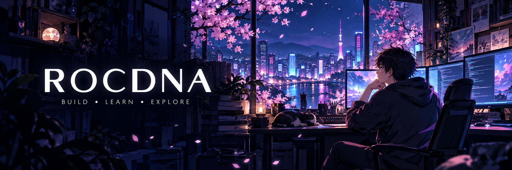

<h1 align="center">Hi, I'm Rocdna 👋</h1>

<b>从模型原理，到智能系统。</b>

研究生 · Agent / RAG / LLM Engineering · 用代码记录探索

  <a href="https://github.com/Rocdna/mini-agent">Mini-Agent</a> ·
  <a href="https://github.com/Rocdna/rag-assistant">RAG Assistant</a> ·
  <a href="https://github.com/Rocdna/transformer_learn">Transformer Learn</a>

### 🌸 About me

- 🧠 正在探索 **Multi-Agent、上下文工程与记忆系统**。
- 🛠️ 用 **Python / PyTorch** 理解模型，用 Web 技术把想法做成应用。
- 📚 从手写 Transformer 出发，继续学习智能系统的工程实现。

### ⚙️ Tech stack

  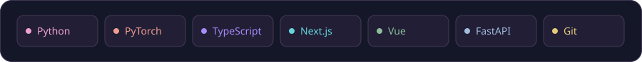

### 🚀 Public projects

<!-- PROJECTS:START -->

  <a href="https://github.com/Rocdna/multi-agent-science-papers">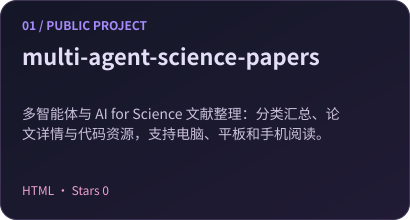</a>
  <a href="https://github.com/Rocdna/mini-agent">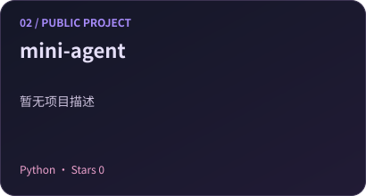</a>
  <a href="https://github.com/Rocdna/transformer_learn">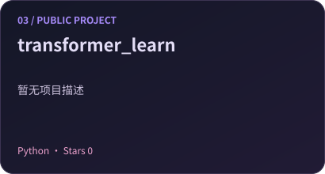</a>
  <a href="https://github.com/Rocdna/rag-assistant">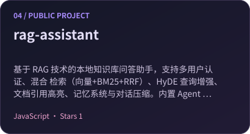</a>
  <a href="https://github.com/Rocdna/chatbot">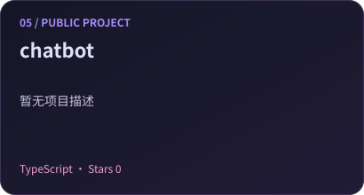</a>
  <a href="https://github.com/Rocdna/ml-notes">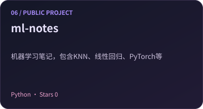</a>
  <a href="https://github.com/Rocdna/item">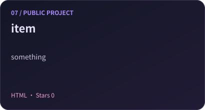</a>
  <a href="https://github.com/Rocdna/graduation-project">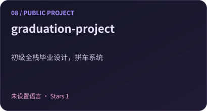</a>
  <a href="https://github.com/Rocdna/pvz-base-on-c">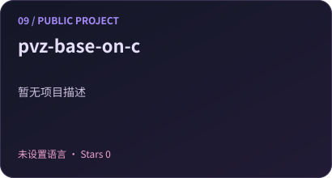</a>
  <a href="https://github.com/Rocdna/next-dashboard-first">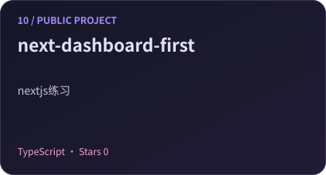</a>
  <a href="https://github.com/Rocdna/wordcloud">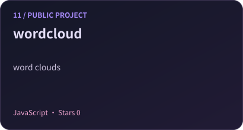</a>
  <a href="https://github.com/Rocdna/coolApp">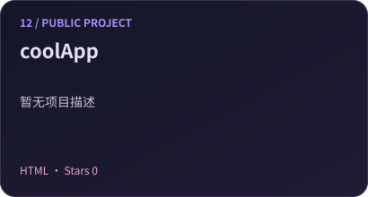</a>
  <a href="https://github.com/Rocdna/blog">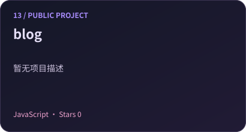</a>
  <a href="https://github.com/Rocdna/rocale.github.io">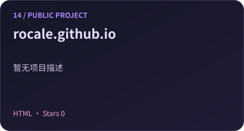</a>
  <a href="https://github.com/Rocdna/Hello">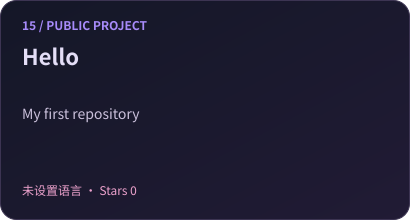</a>

<!-- PROJECTS:END -->

### 📊 GitHub snapshot

  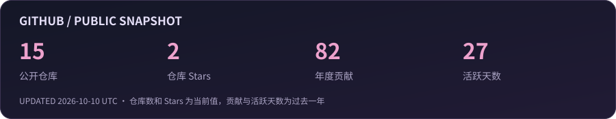 
  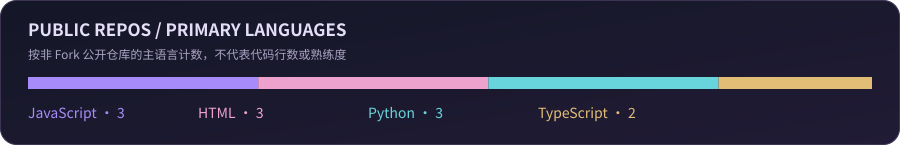

### 🌃 Contribution city

  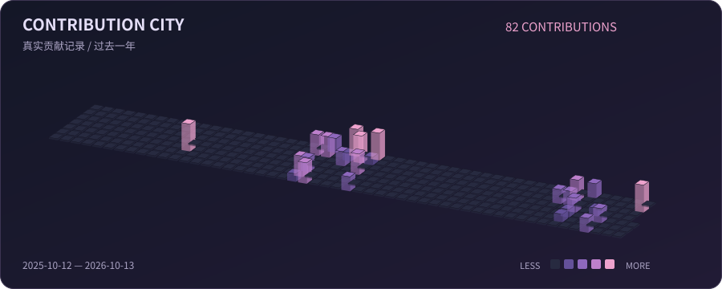

<!-- SNAKE:START -->

<!-- SNAKE:END -->

### ✨ Wallpaper corner

  

Frieren: Beyond Journey's End · 原画：晓盆友 · 动态制作：Deku Scrub · <a href="https://steamcommunity.com/workshop/filedetails/?id=3098540596">作品页</a> / <a href="https://www.pixiv.net/en/artworks/106379857">原画</a>

<i>Keep learning. Keep building.</i>

